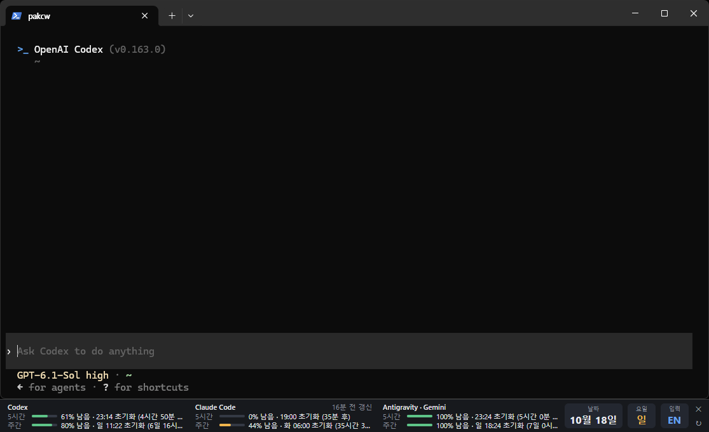

# AIUsageWidget

English | [한국어](README.ko.md)

See your Codex, Claude Code and Antigravity usage limits below your terminal or in a standalone desktop widget. Available for Windows and macOS, in English and Korean.



*Usage panel attached below Windows Terminal.*

## Download and install

[**Download 0.0.10 for Windows**](https://github.com/chojema/AIUsageWidget/releases/tag/v0.0.10)

| Platform | File |
|---|---|
| Windows x64 | [AIUsageWidget-0.0.10-win-x64.zip](https://github.com/chojema/AIUsageWidget/releases/download/v0.0.10/AIUsageWidget-0.0.10-win-x64.zip) |
| macOS Apple Silicon (M-series) | [AIUsageWidget-0.0.9-osx-arm64.zip](https://github.com/chojema/AIUsageWidget/releases/download/v0.0.9/AIUsageWidget-0.0.9-osx-arm64.zip) |
| macOS Intel | [AIUsageWidget-0.0.9-osx-x64.zip](https://github.com/chojema/AIUsageWidget/releases/download/v0.0.9/AIUsageWidget-0.0.9-osx-x64.zip) |

- **Windows:** extract to a permanent folder and run `AIUsageWidget.exe`. Right-click the panel or use the tray menu for Settings, refresh, hide, and quit.
- **macOS 14+:** extract, move `AIUsageWidget.app` to `/Applications`, and open it. Open Settings from the menu bar icon; the app has no Dock icon.
- **Updating:** quit the app and replace it in the same location. Your settings are kept.

No separate .NET installation is needed. Windows may show a SmartScreen warning because the executable is unsigned. The macOS app is not notarized; if opening is blocked, follow [Apple's instructions](https://support.apple.com/102445) and use **Privacy & Security → Open Anyway** only if you trust the download.

## Features

- 5-hour and weekly usage limits, reset times and time remaining.
- Remaining or used percentages, with progress bars.
- Date, weekday, time (optional seconds) and keyboard input indicator, including EN / 한.
- Show, hide and reorder sections in Settings.
- Automatic refresh (every 5 minutes by default), custom intervals or manual refresh.

| Display mode | Behavior |
|---|---|
| **Attach below the terminal window** | Follows the frontmost terminal and hides when another app is in front. |
| **Standalone widget** | Drag anywhere, with an optional always-on-top setting. |

Supported terminals include Windows Terminal, Terminal, iTerm2, WezTerm, Alacritty, Ghostty and Warp. The panel follows windows, not individual tabs.

Use **↻** to refresh and **✕** to hide the panel or quit. Restore a hidden panel with **Show panel** in the tray/menu bar menu. Appearance, language, refresh and close behavior are available in **Settings**. Start at login is available on Windows only.

## Connect your CLIs

| CLI | Setup |
|---|---|
| Codex | Sign in to Codex CLI. |
| Claude Code | Choose **Connect Claude Code** in the tray/menu bar menu. |
| Antigravity | Sign in to Antigravity CLI (1.1.12+). Select a model group in Settings. |

Place the app in a permanent location before connecting Claude Code. Connecting updates `statusLine` in `~/.claude/settings.json`, backs up the file and preserves your existing status line. Disconnecting restores the previous setting. Claude Code values update only while a session is running.

Usage is read through the CLIs' official interfaces. The app does not read or store credentials. See [Security](SECURITY.md).

## Advanced settings

Settings are stored in:

- Windows: `%APPDATA%\AIUsageWidget\settings.json`
- macOS: `~/Library/Application Support/AIUsageWidget/settings.json`

To recognize another terminal, add its Windows process name (without `.exe`) or macOS bundle identifier to `extraTerminals`:

```json
{
  "extraTerminals": ["MyTerminal", "com.example.terminal"]
}
```

## Build from source

Requires the [.NET 10 SDK](https://dotnet.microsoft.com/download).

```sh
dotnet test --solution AIUsageWidget.slnx -c Release
```

Windows:

```powershell
powershell -ExecutionPolicy Bypass -File scripts/publish-windows.ps1
```

macOS (run on a Mac):

```sh
sh scripts/publish-macos.sh arm64   # x64 for Intel
```

App bundles and release zips are written to `dist/`.

[Changelog](CHANGELOG.md) · [MIT License](LICENSE)
